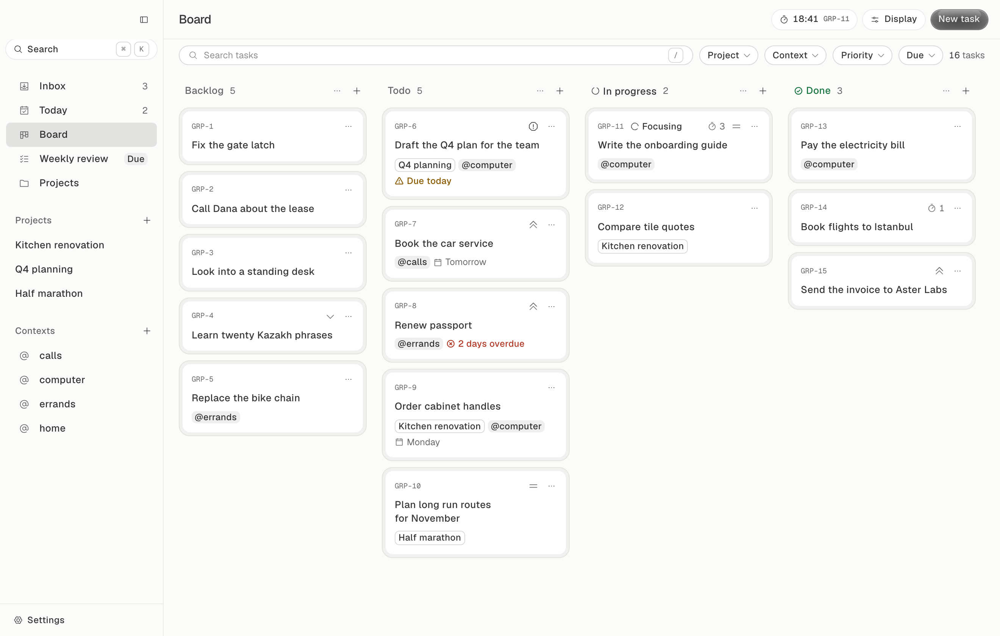
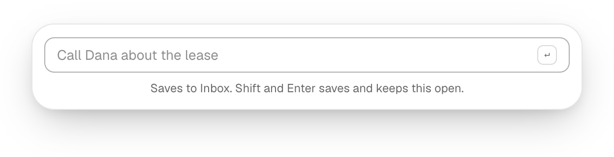
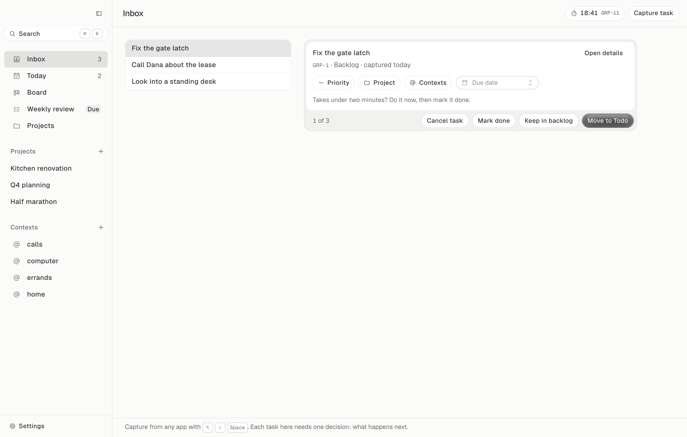

# Gropius

**A calm to-do board for your Mac, built around Getting Things Done, with a Pomodoro timer in the menu bar.**

No account, no cloud, no tracking. Your tasks live in one file on your Mac, and the whole app is about 5 MB.

<picture>
  <source media="(prefers-color-scheme: dark)" srcset="docs/board-dark.png">
  
</picture>

## Features

- **Board.** Backlog, Todo, In progress, Done and Cancelled columns. Hide the ones you don't use. Drag cards with the mouse or the keyboard.
- **Quick capture.** Press <kbd>⌥</kbd> <kbd>⇧</kbd> <kbd>Space</kbd> in any app, type the task, press <kbd>Enter</kbd>. It lands in your Inbox.
- **Inbox.** Go through what you captured, one task at a time, and decide what happens to each.
- **Today.** What is overdue, what is due today and what you are working on.
- **Weekly review.** A short guided review: clear the backlog, unstick stalled tasks, look at the week ahead.
- **Projects and contexts.** Group tasks into projects. Tag them with where you can do them (@calls, @errands, @computer) and filter the board by tag.
- **Pomodoro in the menu bar.** Start a focus session on any task. The time left shows in the menu bar and keeps running when the window is closed. A sound and a notification tell you when to take a break.
- **Keyboard first.** <kbd>⌘</kbd> <kbd>K</kbd> finds any task or command. Almost everything has a shortcut.
- **Light and dark** themes, following your Mac by default.

<p align="center">
  
</p>

## How to use it

Gropius follows the Getting Things Done method in four steps:

1. **Capture.** The moment something comes to mind, press <kbd>⌥</kbd> <kbd>⇧</kbd> <kbd>Space</kbd> and write it down. Don't sort it yet.
2. **Decide.** Open the **Inbox**. For each task, choose one: move it to Todo, keep it in the backlog, mark it done (if it takes two minutes, do it now), or cancel it.
3. **Do.** Work from **Today** and the **Board**. Press <kbd>T</kbd> on a task to start a 25-minute focus session.
4. **Review.** Once a week, run the **Weekly review** to keep the lists honest.



## Install

Gropius runs on **macOS 14 (Sonoma) or later**. There is no prebuilt download yet, so you build it yourself. It takes a few minutes.

**1. Install the tools**, once:

- Xcode Command Line Tools: `xcode-select --install`
- [Node.js](https://nodejs.org) 22 or later
- [Rust](https://rustup.rs): `curl --proto '=https' --tlsv1.2 -sSf https://sh.rustup.rs | sh`

**2. Build the app:**

```sh
git clone https://github.com/Sailaukan/Gropius.git
cd Gropius
npm install
npm run tauri build
```

**3. Move it to Applications:**

```sh
ditto src-tauri/target/release/bundle/macos/Gropius.app /Applications/Gropius.app
open /Applications/Gropius.app
```

If break reminders don't appear, allow notifications for Gropius in **System Settings → Notifications**.

## Keyboard shortcuts

| Keys | Action |
|-|-|
| <kbd>⌥</kbd> <kbd>⇧</kbd> <kbd>Space</kbd> | Quick capture from any app (change it in Settings → General) |
| <kbd>⌘</kbd> <kbd>K</kbd> | Search tasks and commands |
| <kbd>C</kbd> | New task |
| <kbd>⌘</kbd> <kbd>1</kbd> … <kbd>5</kbd> | Inbox, Today, Board, Weekly review, Projects |
| <kbd>J</kbd> / <kbd>K</kbd> | Next / previous task |
| <kbd>Enter</kbd> | Open the task |
| <kbd>1</kbd> … <kbd>5</kbd> | Move the task to Backlog, Todo, In progress, Done, Cancelled |
| <kbd>T</kbd> | Start or pause focus on the task |
| <kbd>⌫</kbd> | Delete the task (<kbd>⌘</kbd> <kbd>Z</kbd> undoes) |
| <kbd>Space</kbd> | Pick up a card, move it with the arrows, <kbd>Space</kbd> again to drop |

The full list is in **Settings → Shortcuts**.

## Your data

Everything is stored in a single SQLite file:

```
~/Library/Application Support/com.sailaukan.gropius/gropius.db
```

- **Back up:** copy that file while Gropius is closed.
- **Start over:** quit Gropius and delete the `com.sailaukan.gropius` folder.

Gropius never connects to the internet.

## Development

```sh
npm install
npm run tauri dev       # runs the app with hot reload
```

While `tauri dev` runs, <http://localhost:1420> also opens the interface in a browser with sample data, which is handy for working on screens. Development builds use a separate database, `gropius-dev.db`.

Before sending a change, run the checks:

```sh
npm run typecheck       # TypeScript
npm run lint:glaze      # design system rules, must report nothing
npm run test:rust       # database and timer tests
```

**Where things are:**

| Folder | What's inside |
|-|-|
| `src/app` | Every screen, written in React |
| `src/lib` | Data, state and the bridge to the Rust side |
| `src/components/glaze` | The Glaze design system components |
| `src-tauri/src` | The Rust side: SQLite database, Pomodoro timer, menu bar item, capture window |

## Built with

- [Tauri 2](https://tauri.app), so the app uses the Mac's own web view and stays small
- React, TypeScript and Tailwind CSS
- SQLite, through [rusqlite](https://github.com/rusqlite/rusqlite)
- [Glaze](https://design.how/systems/glaze), a design system by design.how (MIT)
- [Phosphor](https://phosphoricons.com) icons and the [Geist](https://vercel.com/font) typeface

## License

[MIT](LICENSE). Use it, change it, share it.
